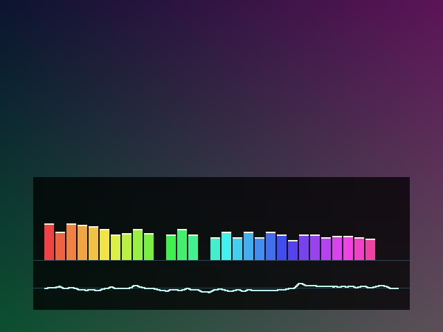

# 彩虹音频频谱与稳定波形

本次参考 `E:\Music-Spectrum-main` 的频谱表现形式，在本工程现有音频旁路实现。
顶层原来的单条时域波形已替换为彩虹频谱加稳定波形；原 `audio_visualizer.v` 保留用于历史测试与兼容，不再实例化到顶层。

## 怎么看、怎么操作

1. 使用原来的 TF 卡和媒体菜单播放 WAV，或切到带音轨的 AVF 视频，无需麦克风、音频采集板、WM8960 或其它新接线。
2. 频谱和波形随音轨自动更新。无音轨或持续静音时，柱条逐渐回落；有 PCM 数据的静音波形回到中心。
3. 长按代码 KEY3（B1）打开原中文菜单，选择“音量”或“静音”，短按 KEY3 进入，KEY1/KEY2 调节，KEY3 返回、长按退出。音量影响分析幅度，因为分析接在最终音量和音效处理之后。
4. 不要把板卡上 A2 对应的复位键当成代码 KEY1；原按键与菜单操作见[按键对照](KEY_RESET_MAPPING_20261023.md)及[媒体菜单](MENU_MEDIA_20261023.md)。
5. 显示跟随原 OSD 总开关，复位默认开启；已有 PS/2 的 O、红外数字 3（NEC `0x5E`）可统一隐藏/显示。没有给 SW 改用途，也没有新增菜单项。
6. 原媒体菜单、字幕、模式两秒提示、参数浮窗和游戏在频谱之后叠加，仍可覆盖频谱的对应区域。

输出和接线不变。频谱可视化能出现，不代表显示器一定能播放声音；640×480 明文 TMDS 核仍是视频输出，没有为本次增加 HDMI 音频包。原有音频输出能力与限制保持原样。

## 显示内容

- 横轴为频率，从左到右由低到高，不是音量通道或左右声道。
- 32 个频段，每段对其覆盖的全部频点取最大幅度，避免只抽一个频点漏掉声音；第一个频段为 187.5Hz，最后一个覆盖 22.5kHz 至 23.8125kHz。直流频点不画成柱条。
- 柱高使用带噪声底的近似对数压缩，不是校准过的 dB 表，不应作为测量仪器。
- 柱条快速上升，每个显示帧最多下降 2 个逻辑像素；顶部浅色峰值标记每 4 帧下降 1 像素。彩虹颜色每 5 帧移动一档。
- 下方波形显示左声道的正、负振幅。四点移动平均用于稳定显示，带滞回的正向过零触发固定起点；持续直流或静音时约 1024 个音频样本后也会触发刷新。
- 菜单关闭时下半屏的频谱底板为原视频颜色的四分之一亮度，频谱条使用彩虹色，不是菜单渐变背景。未覆盖区域透传原视频。

## 与参考工程的取舍

参考工程面向 Xilinx Zynq：1024 点浮点 FFT、80 柱、外部 codec、PS/DDR 帧缓存、FIR IP 和强光混合。
当前实现面向 EG4S20：256 点定点 FFT、32 柱、直接读取已有播放 PCM、光栅叠加，无额外帧缓存；背景使用移位混合，没有照搬强光乘法混合。
这些差异是明确保留的，不称为参考工程的逐项原样移植。

48kHz 采样下 256 点的频率间隔为 187.5Hz，观察窗口为约 5.33ms。低于一个频点的低音分辨能力弱于参考工程的 1024 点方案，不能把柱条数量当成 FFT 精度。
Hann 窗减轻非整数周期输入的频谱泄漏；每级蝶形除以 2，使用 Q1.15 系数、16 位实部/虚部和共享乘法器。
FFT 完成后输出自然顺序频点；分析处理期间会跳过部分分析样本块，不会改变音频播放采样节拍或阻塞播放器。

## 模块与验证

| 文件 | 功能 |
|---|---|
| `src/modules/audio/spectrum_fft256.v` | Hann 加窗、位逆序采集、8 级基 2 FFT、单乘法器分时复用、自然顺序输出 |
| `src/modules/audio/spectrum_coefficients.v` | 内嵌的同步系数 ROM，不依赖工作目录读取文件 |
| `scripts/gen_spectrum_coefficients.py` | 可复现生成 Hann 和旋转因子 |
| `src/modules/audio/spectrum_analyzer.v` | 频段归并、对数压缩、双快照与帧边界发布、柱高和峰值包络 |
| `src/modules/video/music_spectrum.v` | 彩虹绘制、四点平滑/触发波形、同步 RAM 冻结显示、两拍视频流水 |
| `scripts/make_spectrum_vectors.py` | 独立双精度 DFT 数值参考，供回归生成测试向量 |
| `sim/tb_spectrum_fft.v` | 零输入、正负直流、脉冲、单音、复音、满幅与随机输入，逐频点比较 |
| `sim/tb_spectrum_bands.v` | 真实音调归频段、空白期提交、缓降和断流回落 |
| `sim/tb_music_waveform.v` | 触发、滤波、正负极性、冻结快照、无过零超时 |
| `sim/tb_music_spectrum.v` | 两拍 VS/DE/RGB、关闭透传、柱间隙、色彩、峰值、帧边界使能 |

上述四个新测试已登记在主回归 `scripts/run_tests.ps1`。
综合与布局布线资源、时序以及最终交付状态见[本轮结果](../reports/music_spectrum_20261023/RESULT.md)。
仿真预览使用合成谐波，只演示实际 RTL 的渲染结果，不是实板拍摄。

