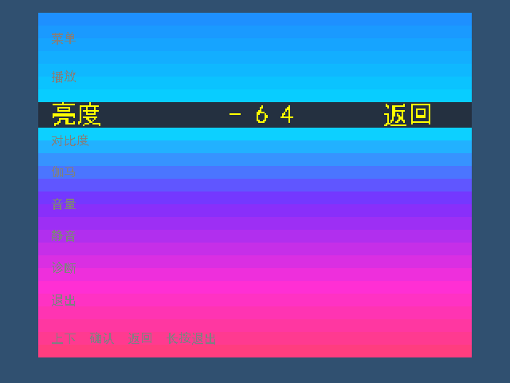
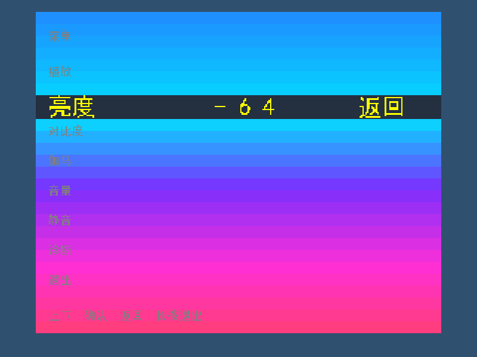

# 中文菜单彩色垂直渐变（2026-10-23）

已按指定27个RGB值，将非选中区域由纯色改为蓝→青→紫→品红→粉的垂直色带，每级16个逻辑像素行。面板范围y=16～447，共432行。

menu_overlay新增与rgb1/panel1/band1等同步的10bit y1寄存器；以gy=y1-16、t=gy[8:4]查case表输出grad。复位清零y1，不增加流水级。选中行仍为243040，选中文字FFFF00、普通文字808080，面板外仍透传rgb1。

构建输入改动仅src/modules/osd/menu_overlay.v和sim/tb_menu_overlay.v；后者同步更新独立像素参考的背景色表，并把本轮截图写入本目录。其他源码、脚本、字体、工程清单、引脚和约束未改。旧文件和已通过的构建记录备份在baseline/。

验证结果：

- static_check：ALL PASS，94 sources、40 IO bits。
- tb_menu_overlay：ALL PASS，10个完整VGA帧、3072000像素。
- tb_menu_overlay_svga：ALL PASS，经原viewport_coordinates验证10个800×600帧、4800000像素。
- 两种模式覆盖全部27级背景、分界行、八个选中项、原文字/状态、关闭旁路、帧锁存和两拍RGB/VS/DE对齐。
- 完整113项RTL主回归全部ALL PASS，主脚本结束为ALL TESTS PASSED、退出码0；另有9项AVF Python测试和1项字体Python测试通过。日志归档在main/，清单见regression.json。
- 综合完成；初次seed25布局最终SWNS -0.016ns、HWNS +0.013ns，未用于生成bit。保留原失败记录后，仅将物理布局seed改为26重新P&R并独立增量布线/hold修复。最终SWNS +0.185ns、HWNS +0.021ns、STNS/HTNS均0；物理LUT 16370/19600、BRAM 57/64、DSP 23/29。没有修改RTL、官方IP、引脚、时钟频率或时序约束。
- TD根工程XML在流程中发生改写，导致原快照检查停止；未把该停止冒充通过。单独核验确认只有video_improve.al快照不同，全部src/scripts/sim哈希、综合清单和原综合网表哈希均一致。综合使用design_sources.tcl直接加载HDL而不读取该GUI工程，当前根/嵌套工程的94源、器件、顶层及引脚再次通过检查。原快照保留，当前构建清单显式记录此核验；不声称已重建原XML逐字节差异。证据见bitstream/project_reconciliation/audit.json及physical_refinement/seed25_failed/build_manifest.json。
- 已生成[新的彩色渐变候选bit](bitstream/video_improve_menu_gradient_20261023.bit)，648248字节；生成前后STA完全一致，源码快照及路由数据库哈希一致。SHA-256为de79a3fdcec39c34782e2a006797fd2efc58f7adce2c2ce226f957ecb5fd431a，详见[bit生成记录](bitstream/RESULT.md)。旧纯色菜单bit保留且未覆盖。
- 未下载到硬件、未实板验收，board_signoff=false；未达到整体+0.5ns。全局HWNS不能作为HDMI管脚hold签核，既有PHY-7002/PHY-5079警告仍保留。

真实RTL仿真截图：

